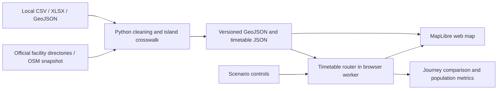

# Maldives critical facilities map and transport simulator: build feasibility

Researched and locally checked on **24 October 2026**. This is a build recommendation, not an implemented application or a validated estimate of national accessibility. Public-source verification is in [03_public_sources_verification.md](03_public_sources_verification.md); earlier dataset profiling is in [02_data_profile_hdx_kandu.md](02_data_profile_hdx_kandu.md).

## 1. Recommendation

Build **one application with two connected views**:

1. **Facilities and connectivity map:** Where are hospitals, health centres, schools, campuses, ferry stops and airports? Which islands and residents do the sources cover?
2. **Transport scenario simulator:** Given a departure time, which facilities can residents reach? What changes when a ferry trip is added, delayed or cancelled, or a facility becomes unavailable?

The existing files support a credible **timetable-based accessibility prototype**. A nationally complete operational journey planner, live fleet tracker, or congestion/capacity prediction model needs additional data. The first release should show national geography and facility coverage, then enable timed simulation only where its inputs support it.

Start with **access to hospitals and regional healthcare**, plus education as a second destination layer. These give a concrete policy question: *which change would let more residents reach a relevant service within a chosen time, or complete a same-day visit?* Keep hospitals, primary care, schools and higher education as separate service categories.

## 2. What is actually available locally

Counts below were checked against the files during this research. Existing scripts and earlier notes provide more extensive profiles. Team Kandu's tables are team-shared extracts, not an operator-certified feed.

| Input | Checked contents | Immediate use | Limitation |
|---|---|---|---|
| `data/team-kandu/rtl_stops.csv` | 149 stop records with coordinates | Ferry nodes and map points | Coordinates need jetty-level checking before precise walking transfers |
| `rtl_routes.csv` + `rtl_trips.csv` | 49 routes; 102 distinct trips; 390 stop-time rows | Reference-day ferry routing | Missing service calendars; covers Zones 1, 2, 4, 5 and 6, not Zone 3 |
| `rtl_connections.csv` | 615 directed reachable stop-pair summaries | Connectivity diagrams and initial static analysis | First/last departures and shortest duration do not reconstruct every feasible itinerary |
| `rtl_unscheduled.csv` | 61 route rows, including an `ERROR` row | Display untimed connectivity | Remove the error; other rows cannot be treated as scheduled service |
| `odi_connections.csv` | 58 connections | Supplementary sea links, including some missing-region coverage | No departure times or travel durations |
| `rtl_bus_routes.csv` / `rtl_bus_stops.csv` | 28 routes; 612 route-stop rows; 402 distinct stop codes | Bus layers and stop sequences | Bus stop codes require namespace checks; map coverage is broader than timetable coverage |
| `rtl_bus_departures.csv` | 1,686 rows | Partial scheduled bus examples | Earlier profiling found only 11 Greater Male routes and evening departures after the extraction time |
| `observations.csv`, table `3.3` | 186 inhabited atoll-island census rows; 236,911 residents | Population weights for matched origins | Also contains totals and other categories that must not be summed as island rows |
| `data/external/hdx-cod-ab/extracted/mdv_admin2.geojson` | 1,556 polygons with island names and `adm2_pcode` | Strong local starting point for an island geometry catalogue | Includes more than inhabited islands; 2024 validity attributes; needs census crosswalk |
| `mdv_admin1.geojson` | 21 administrative units | Atoll overview and filtering | Administrative areas can include water; not land outlines for every purpose |
| `data/external/geoboundaries/` | gbOpen ADM1: 21; gbOpen ADM2: 21; gbHumanitarian ADM3: 210 features | Alternative boundaries and comparison | ADM level names are not equivalent between products; gbOpen ADM2 is not an inhabited-island inventory |
| `data/external/air/ourairports/airports.csv` | 31 Maldives records: 13 small, 4 medium, 3 large airports and 11 seaplane bases | Airport location layer | Records are not proof of current scheduled service, routes or eligibility |
| `maldivian_destinations.csv` | 27 destination records, including international destinations | Airline destination catalogue after filtering | A destination list does not establish airport-pair schedules |
| `data/hdx-heigit-access/` and `data/processed/heigit/` | Healthcare and education accessibility tables and polygons | Existing published baseline layer | Isochrones are not facility points or island boundaries; population and mode assumptions differ |
| `data/external/education/mbs_statistical_yearbook/` | Education spreadsheets/PDFs | Aggregate checks and context | Checked 2025 table 7.5 is atoll-level counts, not a geocoded school directory |
| `data/external/health/mbs_statistical_yearbook/` | Staff, patients, disease and expenditure tables | Healthcare context | The checked sheets do not constitute a complete geocoded facility register |

### Important corrections to the earlier plan

- **MTCC passenger volumes are synthetic.** The workbook README explicitly says the route names/codes are real and passenger figures are randomly generated. Use those volumes only in a clearly labelled demonstration; do not calibrate real demand or claim observed load/capacity benefits from them. Evidence: `data/MTCC/MTCC.xlsx`, `README` sheet.
- **MACL is not a domestic route feed.** Its released traffic records use anonymised route/carrier codes and international regions. No usable domestic airport-pair timetable has been established from that file. Evidence: `data/MACL/MACL/Metadata.csv`, traffic CSV and earlier profiling.
- **FollowMe is not established as road-only data.** Its bundled dictionary calls speed the speed of the boat. Classify tracks before using them; infer elapsed-time travel speeds from cleaned coordinates/timestamps rather than assuming the supplied speed unit. Evidence: `data/FollowMe/FollowMe_august_2025/Summary of the available data.txt`.
- **Missing data is not zero access.** Keep separate states for a journey not found in the model, an origin with missing schedules, and an origin with incomplete facility coverage. Do not fill all omitted HeiGIT units with zero and present that as observed access.
- **Do not reverse-engineer facility locations from isochrones.** Download actual POIs or match an official directory. Multiple possible facility sets can produce a reachable-area polygon.

## 3. Public sources that fill the main gaps

| Need | Verified public starting point | How to use it |
|---|---|---|
| Health facility identity and category | [Ministry of Health directory](https://health.gov.mv/en/health-facilities) and [HEMS establishments registry](https://hems.health.gov.mv/establishments) | Build the authoritative name/category/status list; join to island and mapped coordinates. A listing or licence does not confirm opening hours, beds, current staffing or every clinical service. |
| Schools | [Ministry school directory](https://www.moe.gov.mv/en/schools) | Use named school records and individual pages; inspect location fields. The directory shows an update date of 23 May 2025, so retrieval date is not the data reference date. |
| University campuses | [MNU contacts and campuses](https://mnu.edu.mv/contacts/) | Identifies Male, Gan, Hithadhoo, Kulhudhuffushi and Thinadhoo campuses and addresses. Campus presence does not establish that a particular course is offered there. |
| Higher education institutions | [MQA institutions directory](https://mqa.gov.mv/en/higher-education-institutes) | Discover other providers, then check campus locations with each institution. Do not map only the registered headquarters as all teaching locations. |
| Official island geography | [MLSA National Mapping](https://www.mlsa.gov.mv/nationalmapping.php) and its published [island FeatureServer](https://services7.arcgis.com/yvCbn3q8PPtPLZIM/arcgis/rest/services/island_20240509/FeatureServer) | Metadata was verified; a feature query and full download were not. Test extraction before relying on this service; compare with local COD polygons and align identifiers. Public availability and reuse permission are separate checks. |
| Roads, harbours and facility coordinates | [Geofabrik Maldives downloads](https://download.geofabrik.de/asia/maldives.html) | Extract OSM roads and POIs locally. Match official facility records to OSM candidates; retain unmatched records with an explicit island-level location. |
| Current ferry timetables | [RTL](https://rtl.mv/) | Check extracted schedules against operator information; obtain service days, exceptions and missing routes. Do not depend on an undocumented API remaining accessible. |
| Census source checks | [MBS Census 2022 results summary](https://statisticsmaldives.gov.mv/census-2022-results-summary/) and source URLs in `observations.csv` | Verify resident-population geography and build a non-overlapping analysis denominator. |

Exact API query checks and source limitations are recorded in the companion public-source note. No complete public Maldives GTFS or GTFS-Realtime feed was established in this research.

## 4. Build the facilities map

Create a canonical island table before joining the other datasets:

```text
islands: island_id, source_pcode, atoll_id, name, geometry,
         representative_point, resident_population, population_year
island_aliases: source, source_name, source_atoll, island_id, reviewed
facilities: facility_id, category, subtype, name, island_id, geometry,
            location_precision, operational_status, service_tags,
            source_url, source_reference_date, retrieved_at
transport_stops: stop_id, mode, source_stop_id, island_id, geometry
```

Use a stable internal island ID with separate source identifiers. Match atoll plus island name, preserve Dhivehi/English names, and review uncertain aliases. Fuzzy matching should propose candidates; it must not silently merge different islands. Airport islands, connected settlements and combined stops such as Hulhumeedhoo need explicit handling.

Match facility coordinates from official location pages or OSM against the official register. If only the island is known, use a distinct island-level marker and record `location_precision=island`; exclude it from claims of exact doorstep travel time. Deduplicate a facility represented by both an OSM building and a POI node. A facility's absence from OSM is a mapping gap, not evidence that the island has no facility.

The interface should provide category filters, island/atoll search, facility details with source dates, route selection, and a coverage layer. At national zoom use visible island dots or clusters; tiny island polygons alone will be hard to select. At local zoom reveal facilities, stops and walking connectors. Keep unknown coverage visibly distinct from modelled poor access.

Start with hospitals, health centres, schools, campuses and transport gateways. Police, fire, power, water and emergency shelters can follow when an appropriate directory and location data have been checked; OSM-only entries should carry their provenance.

## 5. Build the simulator around timetables

### Routing model

Use origin points, ferry/bus stops and facilities as nodes. Connect them through:

- walking or road access on the same physically connected land network;
- scheduled transit legs with departure, arrival and trip identity;
- transfer links with explicit walking and boarding allowances;
- optional hypothetical links, kept separate from the reference timetable.

**Do not use ordinary shortest paths over `shortest_minutes` as the final journey calculation.** A traveller may wait hours or miss the last departure. Preserve trip identity so staying aboard the same boat does not incur a new boarding buffer at each intermediate stop.

For the current small ferry network, a **time-expanded event graph with Dijkstra** is a straightforward prototype: arrival/departure events, ride edges, waiting edges and transfer edges. Use absolute service-day times and the Maldives timezone (`Indian/Maldives`, UTC+5). Handle the next day explicitly if the scenario allows overnight journeys; do not silently repeat a timetable forever.

Alternatively use a tested timetable-routing implementation. [RAPTOR](https://www.microsoft.com/en-us/research/wp-content/uploads/2012/01/raptor_alenex.pdf) supports arrival-time/transfer tradeoffs and dynamic scenarios. [OpenTripPlanner](https://docs.opentripplanner.org/en/latest/) is the stronger integration path once GTFS and street data are ready, but its deployment and data preparation add work to a short prototype.

### Convert the ferry tables to an interchange format

The [GTFS Schedule reference](https://gtfs.org/documentation/schedule/reference/) supplies the format:

| GTFS component | Input / decision |
|---|---|
| `agency.txt` | RTL operator metadata and Maldives timezone |
| `stops.txt` | Ferry stop code, name and coordinates |
| `routes.txt` | Route identifiers; ferry `route_type=4` |
| `trips.txt` | Distinct route/trip combinations with unique IDs |
| `stop_times.txt` | Ordered `rtl_trips` times; single recorded time needs an explicit arrival/departure assumption |
| `calendar.txt` / `calendar_dates.txt` | **Not present locally**; obtain verified calendars or define a clearly labelled demonstration service day |
| transfers, shapes, fares | Add only when sourced or explicitly assumed |

A technically valid feed with invented daily calendars is still an assumed schedule. Keep the initial interface labelled **reference timetable** until service calendars are verified. Untimed ODI links and unscheduled routes belong in a separate estimated scenario, not the timed baseline.

### Scenario controls

| Control | Model operation | Report |
|---|---|---|
| Add a morning trip | Insert a complete trip with its stop sequence and times | Earlier facility arrival, newly reachable islands/residents |
| Cancel a trip or close a terminal | Remove the affected trip/boarding opportunities | Lost journeys, increased waiting, alternative connections |
| Delay a ferry | Update consistent downstream event times | Missed transfers and arrival changes |
| Change travel speed | Recalculate selected hypothetical or sourced leg times | Sensitivity to the speed assumption |
| Close/add a facility | Change eligible destinations; keep hypothetical facilities labelled | Catchment and accessibility changes |
| Change visit duration | Add time at destination before computing the return journey | Same-day return feasibility |

Adding frequency must create actual departures. Multiplying an edge's speed or dividing a travel time by frequency does not model ferry waiting. An added trip also needs a vessel and operating time; without fleet and cost inputs, describe the accessibility gain without claiming operational feasibility or an optimal investment.

### A concrete example from the existing data

`rtl_trips.csv` contains route **Z2R18**:

```text
B.Dharavandhoo 15:05 -> B.Maalhos 15:15 -> B.Eydhafushi 15:30
```

For someone ready at Dharavandhoo's stop at **09:00**, that recorded trip arrives at **15:30**: **6 h 30 min elapsed**, including **6 h 5 min waiting** and **25 min aboard**. This is that trip's timing, not a claim that no faster alternative exists across the network.

A hypothetical additional **09:30** departure with the same leg durations would arrive at **09:55**, or **55 min elapsed**. That is an illustrative **5 h 35 min** improvement for this itinerary. Confirm the chosen destination facility, walking access, service calendar and competing routes before turning this into a healthcare-access result. A return journey needs its own valid timetable; do not assume symmetry.

## 6. Metrics and evidence rules

For each origin, departure time and service category, compute elapsed time to the earliest reachable eligible facility, including access, waiting, transit, transfers and final walking. If opening hours or service availability are unknown, call the result **physical access to a listed facility**, not access to a confirmed appointment or treatment.

Report:

- residents within configurable thresholds such as 60, 120 and 240 minutes;
- waiting versus aboard/walking time;
- islands with a feasible same-day return after a stated visit duration;
- scenario change in reachable residents and journey time;
- matched population, schedule coverage and facility-location confidence.

Use `sum(population * within_threshold) / sum(population)` over a stated, non-overlapping origin set. Publish both coverage and the result; do not hide incomplete origins by dropping them from the denominator. Keep uncertain origins in an unknown category and, where useful, give lower/upper bounds.

The **186 atoll-island rows total 236,911 residents**. The separate **Maale aggregate is 211,908**, including the listed wards/areas. Together those scopes total **448,819**, compared with the **515,132** republic total; a further **66,313** are in a non-admin-island category. Do not double-count Maale and its component wards, or assign the non-admin category to Seenu simply because its parsed `group` says `S`. Filter `source_table` as text and `date=2022`; registered population in later years is a different measure. Evidence: `data/team-kandu/observations.csv`.

HeiGIT can be displayed as a separately labelled published model. Its modes, facility inputs, population denominator and geography differ, so a percentage difference from the new model cannot be attributed solely to adding ferries. Earlier local notes contain stronger claims; this recommendation supersedes them for comparison design.

## 7. Practical architecture

Recommended prototype, based on this dataset size:



- **Preparation:** existing Python environment, pandas/openpyxl and GeoPandas/Shapely; QGIS for visual inspection of joins and geometry.
- **Web map:** [MapLibre GL JS](https://maplibre.org/maplibre-gl-js/docs/) with GeoJSON island, facility, stop and route layers. Use the team's familiar UI framework. Ordinary map layers suffice initially; deck.gl is optional for large track playback.
- **Routing:** small reference timetable plus a TypeScript event-graph router in a Web Worker. This supports editable scenarios without a running server. A Python API is an alternative if the team is faster in Python; avoid maintaining two routing implementations.
- **Storage:** versioned static files for the prototype, with a manifest recording source, retrieval/reference dates, licence and assumptions. Move to PostGIS and an API when editing, refresh jobs or larger datasets require them.
- **Basemap:** select a tile provider or self-hosted tiles and preserve required attribution. An open-source renderer does not supply unlimited basemap hosting. The [OSM tile policy](https://operations.osmfoundation.org/policies/tiles/) governs use of the public standard tile servers.

Snapshot external inputs before presenting. The demo should not depend on an Overpass request or operator website completing live. For sea routes, draw schematic connections unless a measured path exists; straight segments are not navigable marine routes. Land connectors must not jump across water merely because points are close.

FollowMe can later support historical route replay and empirical travel-time distributions after filtering bad/stale timestamps, implausible movements and land/sea classes. Keep device IDs out of public output. Avas completed rides can inform Greater Male road-transfer times after checking statuses, outliers and sample bias. Neither sample alone establishes national demand. Flight simulation follows only after sourcing airport-pair schedules and passenger-usable transfer rules.

## 8. Delivery sequence and completion checks

Indicative effort for a small team already comfortable with the chosen tools; these are estimates, not a promise of national data cleaning in one day.

| Stage | Deliverable | Indicative effort / dependency |
|---|---|---|
| 1 | Island catalogue, population scope and alias review queue | 1–2 hours for an initial pilot; full national reconciliation may take longer |
| 2 | National map shell and sourced facility layers; approximate locations marked | 2–3 hours for an initial reviewed subset; directory extraction/geocoding is the main variable |
| 3 | Reference-day ferry routing and journey breakdown | 2–3 hours after stop/trip joins are clean |
| 4 | Add/cancel/delay scenario and before/after metrics | 1–2 hours after the router works |
| 5 | Journey spot-checks, assumptions panel and reproducible demo | 1–2 hours |
| Later | Full calendars, Zone 3, street transfers, flights, measured reliability and capacity | Depends on obtaining and validating the missing data |

For a short datathon, parallel team work can overlap map and router preparation. If time runs short, show national data coverage and a reviewed pilot atoll; do not invent national schedules to make the map look complete.

Before calling the prototype ready:

1. Every included trip references valid stops, preserves direction and has ordered times.
2. Manually check journeys involving a missed departure, same-boat intermediate stop, transfer, last service, and unavailable destination.
3. Adding a trip cannot worsen an earliest-arrival result when all else is fixed; removing one cannot improve it. Check population totals and avoid double-counted wards.
4. Confirm that changing a reference-day assumption is visible in both the map and exported result.
5. Check at least one useful scenario end to end with the operator timetable and an official destination listing.

**Recommended first demonstration:** choose a reviewed regional hospital catchment within the timed ferry data; show a baseline journey, add a morning departure, and compare arrival times and the residents newly within a chosen threshold. This connects both requested end goals to a measurable transport-planning decision.
